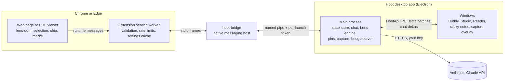

# Hoot

**Hoot is an AI desktop buddy for Windows**: a little owl in your tray that
floats on screen. Summon it, circle anything on your screen, and ask Claude
about it. It grows from a dot to a pill, a chat card and a full Studio.

**Hoot Lens** is Hoot's reading aid. Select text you don't understand on a web
page or in a PDF, and Hoot rewrites it in place so you can understand it. It
marks every change, undoes it with one click, and learns from what you keep.

The design is in [`docs/hoot-lens.md`](docs/hoot-lens.md), the plan to the
hackathon build in [`docs/finish-plan.md`](docs/finish-plan.md), and the rules
for contributors in [`AGENTS.md`](AGENTS.md).

## Setup (Windows 11, Node 24, Chrome or Edge)

From a clean clone, in PowerShell:

```powershell
git clone https://github.com/Nika533/hacktober.git
cd hacktober
npm.cmd ci                                       # 1. install
npm.cmd run build                                # 2. build every package, the app and the extension
npm.cmd run register-host -w @hoot/bridge        # 3. let Chrome and Edge find the app
$env:ANTHROPIC_API_KEY = "<your key>"            # 4. optional: or paste it in onboarding
npm.cmd run dev                                  # 5. run Hoot
```

6. Load the extension: open `chrome://extensions` (or `edge://extensions`), turn on
   **Developer mode**, choose **Load unpacked** and pick `apps\extension\dist`.

Get a Claude API key (it starts with `sk-ant-`) at
[console.anthropic.com](https://console.anthropic.com/settings/keys).

### Offline fallback

Everything also runs with no key and no network, on built-in fakes:

```powershell
$env:HOOT_FAKE_AI = "1"; $env:HOOT_FAKE_LENS = "1"
npm.cmd run dev
```

`$env:HOOT_USER_DATA = "$env:TEMP\hoot-demo"` starts from a fresh profile.

### Installer

`npm.cmd run build:win` writes `apps\desktop\dist\Hoot-<version>-setup.exe`, an
unsigned per-user installer that also registers the extension's native host.
CI keeps the latest one as the `hoot-installer` artifact. Smart App Control can
block unsigned installers; the dev build above always works.

## Demo script

1. Fresh install: onboarding asks for a **Claude** key, then `Ctrl+Shift+Space`
   summons the owl.
2. `Ctrl+Alt+Space`: circle a chart, choose **Explain**. The answer streams; pin
   it as a sticky note.
3. Chrome with the extension: on an article, select "heteroscedasticity". Click
   the Ask-first chip. The term is glossed in place with a mark, and hovering
   shows the original. **I knew this** restores it, and Studio's "What Hoot knows
   about me" lists the term as known.
4. A legal terms page: the dense sentence gets a gloss only, with the
   reading-aid disclaimer.
5. Copy a term: nothing happens.
6. *(Stretch)* Linger without clicking and Lens triggers on its own. A
   foreign-language sentence is translated. A PDF opens in the Lens viewer, gets
   a rewrite overlay, then switches to reflow mode.

## How it fits together



- **One brain:** the Lens engine, the reading profile and the Claude key live in
  the app's main process. The extension and the Reader are thin clients.
- **One state:** main owns every state slice and pushes patches to the windows
  that subscribe to them. Renderers never write state directly.
- **Contracts first:** every IPC channel, bridge message and state slice is
  defined and validated in `packages/core`
  ([CONTRACTS.md](packages/core/CONTRACTS.md)).

| Path | What |
|---|---|
| `apps/desktop` | The Electron app: main process, Buddy, Studio, Reader, notes, capture |
| `apps/extension` | The Hoot Lens browser extension (Chrome, Edge) |
| `packages/core` | Shared contracts, schemas and pure logic (Lens scoring, guardrails, prompts) |
| `packages/ui` | Design system and shared chat UI |
| `packages/lens-dom` | In-page Lens: selection, rendering, marks |
| `packages/pdf-view` | PDF view used by the extension and the Reader |
| `packages/bridge` | hoot-bridge and its registration, linking the extension to the app |

## Development

| Command | What |
|---|---|
| `npm.cmd test` | Unit tests (all packages) |
| `npm.cmd run typecheck`, `npm.cmd run lint` | Type and lint checks |
| `npm.cmd run e2e:desktop`, `npm.cmd run e2e:extension` | End-to-end tests on the fakes |
| `npm.cmd run test:live` | Live Claude checks (needs `ANTHROPIC_API_KEY`) |
| `npm.cmd run smoke:packaged` | Packaged smoke test (after `npm.cmd run build:unpack -w @hoot/desktop`) |

## Privacy

Chats, captures, pins, settings and the Lens reading profile are stored
**locally** under `%APPDATA%\Hoot`. The Claude API key is encrypted at rest with
Windows DPAPI (Electron `safeStorage`) and never leaves the app.

Text and images go to Anthropic's Claude API **only** when you send a message, or,
with Lens turned on, for text you select. Lens sends the selection, its
paragraph, the page title and headings, and a short summary of your reading
profile (terms on that page you know or find hard, your languages and style).
In Ask first mode nothing is sent until you click the chip. In Auto mode a
selection may first be sent to check whether it needs help. Lens never runs on
banking, health, email, password and private pages.

**What Anthropic does with it:** Anthropic doesn't train its models on what Hoot
sends with your API key, and deletes it within 30 days (longer only if it's
flagged under Anthropic's Usage Policy). See
[Anthropic's terms](https://www.anthropic.com/legal/commercial-terms).
